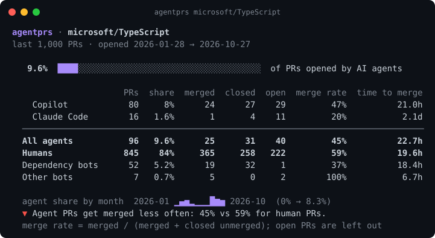
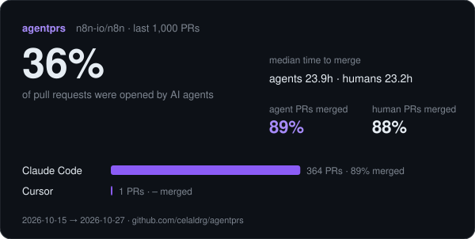

<div align="center">

# agentprs

**How do AI agents' pull requests fare in this repo?**

One command shows how many PRs Copilot, Claude Code, Codex, Cursor, Devin, Jules and friends opened in any GitHub repository,
how often those PRs get merged, and how fast, next to the human baseline.

[](https://github.com/celaldrg/agentprs/actions/workflows/ci.yml)
[](https://github.com/celaldrg/agentprs/releases)
[](https://pkg.go.dev/github.com/celaldrg/agentprs)
[](LICENSE)




</div>

## Try it in 10 seconds

```sh
# any public repo, no install (needs Go 1.22+)
go run github.com/celaldrg/agentprs@latest vercel/next.js

# or install it
go install github.com/celaldrg/agentprs@latest
agentprs home-assistant/core
```

No Go? Grab a binary for Linux, macOS or Windows from the [latest release](https://github.com/celaldrg/agentprs/releases/latest).

Inside a clone you can drop the argument: `agentprs` reads the `origin` remote.
Without a token GitHub allows 60 API calls an hour, enough for ~6 repos. Set `GITHUB_TOKEN` (or `GH_TOKEN`)
to get 5,000. A token with **no scopes** is enough for public repositories.

## Why

Coding agents now open pull requests on their own. Copilot gets assigned issues, Codex and Cursor run in the cloud,
Claude Code writes the PR description and the code behind it. Maintainers are asking the same questions everywhere:

- *How much of our PR queue is agent work now?*
- *Do those PRs actually get merged, or do we spend review time closing them?*
- *Is it getting better or worse month by month?*

[PR Arena](https://github.com/aavetis/PRarena) answers this for GitHub as a whole. agentprs answers it **for your repo**, in one command.

## We ran it on popular repos

`agentprs <repo>` on 2026-10-27, last 1,000 PRs of each repo. Merge rate = merged / (merged + closed without merging).

| Repository | PRs opened by agents | Agent PRs merged | Human PRs merged | Agents seen |
|---|---:|---:|---:|---|
| [n8n-io/n8n](https://github.com/n8n-io/n8n) | **36.5%** | 89% | 88% | Claude Code 364, Cursor 1 |
| [PostHog/posthog](https://github.com/PostHog/posthog) | **34.1%** | 90% | 97% | Claude Code 341 |
| [home-assistant/core](https://github.com/home-assistant/core) | **24.6%** | 97% | 95% | Claude Code 245, Cursor 1 |
| [supabase/supabase](https://github.com/supabase/supabase) | **10.7%** | 89% | 87% | Claude Code 97, Cursor 10 |
| [microsoft/TypeScript](https://github.com/microsoft/TypeScript) | **9.6%** | 45% | 59% | Copilot 80, Claude Code 16 |
| [dotnet/runtime](https://github.com/dotnet/runtime) | **7.1%** | 75% | 88% | Copilot 69, Claude Code 2 |
| [denoland/deno](https://github.com/denoland/deno) | **3.8%** | 64% | 80% | Claude Code 38 |
| [facebook/react](https://github.com/facebook/react) | **3.4%** | 50% | 52% | Claude Code 32, Cursor 2 |
| [withastro/astro](https://github.com/withastro/astro) | **2.1%** | 40% | 76% | Claude Code 21 |
| [cloudflare/workers-sdk](https://github.com/cloudflare/workers-sdk) | **1.8%** | 67% | 79% | Claude Code 15, Devin 2, Cursor 1 |
| [vercel/next.js](https://github.com/vercel/next.js) | **1.6%** | 71% | 80% | Claude Code 16 |
| [microsoft/vscode](https://github.com/microsoft/vscode) | **1.4%** | 40% | 90% | Copilot 11, Claude Code 3 |
| [microsoft/playwright](https://github.com/microsoft/playwright) | **1.2%** | 33% | 72% | Claude Code 7, Copilot 5 |
| [astral-sh/uv](https://github.com/astral-sh/uv) | **0%** | – | 80% | none |

What stands out:

- **Where the team itself drives the agent, agent PRs merge like human PRs.** n8n, Home Assistant and Supabase
  maintainers open Claude Code PRs from their own accounts, and those merge at the same rate as everything else.
- **Elsewhere, agent PRs get closed more often.** In 11 of the 15 repos where both rates could be measured, agent
  PRs were merged at least 3 points less often than human PRs. Small samples (a dozen PRs) are noisy, so read the
  PR counts before the percentages.
- Windows matter: the last 1,000 PRs cover 3 days in PostHog and 9 months in TypeScript.

Left out on purpose: `pytorch/pytorch` lands PRs through a merge bot that closes them instead of merging, so every
merge rate there is near zero; `openai/codex` mirrors its PRs through an internal bot, so no PR has a visible agent signature.

## What you get

- **Share**: what fraction of recent PRs each agent opened, plus dependency bots and other automation kept apart
  so they don't skew the human baseline.
- **Outcomes**: merged, closed without merging and still open, per agent and in total.
- **Merge rate** and **median time to merge**, for agents vs humans, with a one-line verdict.
- **Trend**: agent share month by month, as a sparkline.
- **A shareable card and a badge** (SVG) for your README, plus `--json` and `--markdown` for scripts and job summaries.
- **A GitHub Action** that writes the report into your job summary.
- **Single static binary, zero dependencies**: Go standard library only.



## Usage

```text
agentprs [owner/repo | github URL] [options]

  --limit <n>          look at the n most recent PRs (default 1000)
  --since <when>       only PRs opened after a date (2026-01-01) or age (90d, 6m, 1y)
  --json               print the full report as JSON
  --markdown           print a Markdown summary (PR comments, job summaries)
  --badge <file.svg>   write a shields-style badge
  --badge-label <s>    badge label (default "agent PRs")
  --card <file.svg>    write a shareable SVG report card
  --input <file.json>  read PRs from a saved GitHub API response instead of the network
  --list-agents        print the agents agentprs recognises and how
  --no-color           disable colors (also respects NO_COLOR)
```

GitHub Enterprise: set `GITHUB_API_URL` (for example `https://github.example.com/api/v3`).

### Put a badge in your README

```sh
agentprs --badge docs/agentprs.svg --card docs/agentprs-card.svg
```


### GitHub Action

Add the report to every run's job summary, and keep the badge fresh:

```yaml
# .github/workflows/agentprs.yml
name: agentprs
on:
  schedule: [{ cron: "0 6 * * 1" }]
  workflow_dispatch:
jobs:
  report:
    runs-on: ubuntu-latest
    steps:
      - uses: actions/checkout@v7
      - uses: celaldrg/agentprs@v0.1.0
        with:
          args: --since 90d
          badge: docs/agentprs.svg
```

## How it works

1. Fetch the most recent pull requests with the GitHub REST API (`GET /repos/{owner}/{repo}/pulls`, 100 per call).
2. Classify each PR by **who signed it**, never by how the text "sounds":
   - the **GitHub App that opened it**, e.g. `Copilot`, `devin-ai-integration[bot]`, `google-labs-jules[bot]`,
     `claude[bot]`, `cursor[bot]`, `kiro-agent[bot]`;
   - or a **footer or task link the agent writes into the PR body**, which catches cloud agents that open PRs
     under the human's account: `chatgpt.com/codex/tasks/…` (Codex), `Generated with [Claude Code]` and
     `claude.ai/code/session_…` (Claude Code), the *Open in Cursor* button and `cursor.com/agents` links (Cursor),
     `app.devin.ai/sessions/…` (Devin).
3. Dependency bots (Dependabot, Renovate, pre-commit.ci…) and other bots are counted separately.
4. Count outcomes and compute medians. A merge rate needs at least 5 finished PRs, otherwise it shows `–`.

Run `agentprs --list-agents` to see every rule. Recognised today: **Copilot, Codex, Claude Code, Cursor, Devin,
Jules, Kiro, Amazon Q, Factory, cto.new, Codegen, CodeRabbit, OpenHands, Sweep**.

## Honest limits

- **Lower bound.** An agent that leaves no signature is counted as human. Many people delete the Claude Code footer;
  local agents (Aider, Cline, Cursor in the editor) usually leave none on the PR. If you want commit-level
  attribution, see [aiblame](https://github.com/celaldrg/aiblame).
- **"Opened by an agent" is about the PR, not every line in it.** A human may have edited the agent's branch before merge.
- **Merge workflows differ.** Repos that land changes with a bot that closes PRs (pytorch's merge bot, some
  Gerrit mirrors) or that squash through a separate queue can show low merge rates for everyone. Compare agents
  with humans *in the same repo*, not across repos.
- **A PR template that contains an agent footer** would make every PR look agent-made. Rare, but check `--json`
  (`evidence`, `example_url`) when a number looks too high.
- Recent windows include open PRs; they don't count toward merge rates until they finish.

## Compared with

| | agentprs | [PR Arena](https://github.com/aavetis/PRarena) | GitHub Insights |
|---|---|---|---|
| Scope | **one repo**, any repo | all of GitHub, per agent | one repo |
| Agents vs humans in the same repo | yes | no | no |
| Agents detected | 14, from author or body signature | 6, from branch/author search | none |
| Runs locally / in CI | yes, single binary + Action | website | website |

PR Arena is great for "which agent wins overall". agentprs is for "what happens in *my* repo".

## Roadmap

- [ ] Per-reviewer view: who reviews agent PRs, and how many review rounds they need
- [ ] Reverts: how many merged agent PRs were reverted later
- [ ] Compare two periods (`--compare 90d`)
- [ ] GraphQL backend to fetch 1,000 PRs in fewer calls
- [ ] Organisation-wide report (`agentprs --org my-org`)
- [ ] More agents: Aider, Cline, Amp, opencode and Gemini CLI PR signatures

Ideas and agent signatures are very welcome. See [CONTRIBUTING.md](CONTRIBUTING.md).

## Related

- [aiblame](https://github.com/celaldrg/aiblame): how much of the code in a repo was written by AI, from commit trailers.
- [PR Arena](https://github.com/aavetis/PRarena): GitHub-wide merge rates for coding agents. agentprs takes the idea down to a single repo.

## License

[MIT](LICENSE) © Celalettin Durğaç
